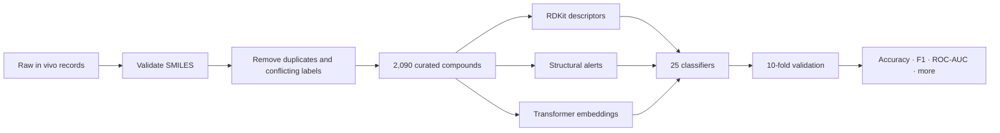

<div align="center">
  <h1>Carcinogenicity Classifying</h1>
  <p><strong>A cheminformatics machine-learning benchmark</strong></p>
  
  
  
  
</div>

## What is this project?

**Carcinogenicity Classifying** is an experimental machine-learning study for binary classification of chemical compounds from their **SMILES** representations and in vivo carcinogenicity labels.

The central question is simple:

> How much does the representation of a molecule change the quality of a carcinogenicity classifier?

To investigate it, the project compares handcrafted molecular descriptors, structural alerts and transformer-based embeddings under the same broad model-evaluation workflow.

## At a glance

| | |
| --- | --- |
| **Curated dataset** | 2,090 compounds after validation, deduplication and removal of conflicting labels |
| **Target balance** | 1,286 negative · 804 positive compounds |
| **Representations** | Descriptors · structural alerts · transformer embeddings · hybrid feature sets |
| **Classifiers** | 25 models, from linear baselines and SVMs to tree ensembles and gradient boosting |
| **Validation** | 10-fold stratified cross-validation |
| **Metrics** | Accuracy · balanced accuracy · F1 · ROC-AUC · precision · recall |
| **Imbalance strategies** | Original distribution · random undersampling · SMOTE |

## Experiment design



### Molecular representations

| Family | Notebook | Description |
| --- | --- | --- |
| `DESC` | [`DESC_invivo.ipynb`](./DESC_invivo.ipynb) | RDKit molecular descriptors |
| `DEST` | [`DEST_invivo.ipynb`](./DEST_invivo.ipynb) | Descriptors combined with structural-alert features |
| `EMB` | [`EMB_invivo.ipynb`](./EMB_invivo.ipynb) | Embeddings from seven pretrained language models, including ChemBERTa and MoLFormer |
| `EMBDESC` | [`EMBDESC_invivo.ipynb`](./EMBDESC_invivo.ipynb) | Transformer embeddings combined with molecular descriptors |
| `EMBDEST` | [`EMBDEST_invivo.ipynb`](./EMBDEST_invivo.ipynb) | Embeddings combined with descriptors and structural alerts |

The model zoo includes logistic and ridge classifiers, SVM variants, nearest neighbors, decision trees, random forests, Extra Trees, boosting methods, an MLP, XGBoost, LightGBM and CatBoost.

## Results

The table below highlights the best recorded configuration for each headline metric. Values are **mean ± standard deviation across 10 folds**.

| Best by | Representation · strategy · model | Score |
| --- | --- | ---: |
| **F1** | Descriptors + structural alerts · SMOTE · LightGBM | **0.744 ± 0.039** |
| **ROC-AUC** | Descriptors + structural alerts · original · XGBoost | **0.872 ± 0.023** |
| **Accuracy** | Descriptors + structural alerts · original · Extra Trees | **0.814 ± 0.027** |
| **Balanced accuracy** | Descriptors + structural alerts · SMOTE · LightGBM | **0.794 ± 0.030** |

The strongest current results come from **molecular descriptors enriched with structural alerts**. In this dataset and evaluation setup, those domain-informed features outperform the tested standalone transformer embeddings — a useful reminder that newer representations are not automatically better for every scientific problem.

Explore the full fold-aggregated outputs in [`Results/`](./Results/) and the comparison and statistical-analysis notebook in [`Results.ipynb`](./Results.ipynb).

## Repository guide

```text
.
├── Dataset in vivo.csv      # source records committed to the repository
├── DESC_invivo.ipynb        # molecular descriptors
├── DEST_invivo.ipynb        # descriptors + structural alerts
├── EMB_invivo.ipynb         # pretrained molecular/text embeddings
├── EMBDESC_invivo.ipynb     # embeddings + descriptors
├── EMBDEST_invivo.ipynb     # embeddings + descriptors + alerts
├── Results.ipynb            # comparison, ranking and statistical tests
└── Results/                  # aggregated metrics for every experiment
```

## Getting started

```bash
git clone https://github.com/Barboss4/Carcinogenicity-Classifying.git
cd Carcinogenicity-Classifying

python -m venv .venv
# Windows: .venv\Scripts\activate
# macOS/Linux: source .venv/bin/activate

python -m pip install jupyter pandas numpy scipy matplotlib seaborn \
  scikit-learn imbalanced-learn rdkit torch transformers \
  xgboost lightgbm catboost tqdm joblib scikit-posthocs aeon

jupyter lab
```

Start with [`DESC_invivo.ipynb`](./DESC_invivo.ipynb) for the lightest experiment, or open [`Results.ipynb`](./Results.ipynb) to explore the completed benchmark.

## Reproducibility notes

- The notebooks preserve the original exploratory workflow and recorded outputs.
- Some cells refer to the local dataset name `in vivo + cpdb.csv`; the version committed here is named `Dataset in vivo.csv`, so update that path before rerunning.
- Experiments that use structural alerts also expect `Estruturas de alerta.csv`, which is not currently included in the repository.
- Transformer experiments download pretrained checkpoints and can benefit substantially from a CUDA-capable GPU.
- Randomized estimators and sampling steps use `random_state=42` where supported.

## Responsible use

This repository is a **research and educational prototype**. Its predictions are not a substitute for toxicological studies, expert review or regulatory assessment, and should not be used as clinical or safety decisions on their own.

## Author

Created by **[Iuri Barbosa](https://github.com/Barboss4)** — connecting health-science questions with data and machine learning.

Questions or ideas? Reach out on [LinkedIn](https://www.linkedin.com/in/iuri-barbosa-355709a9/) or by [email](mailto:barbosa.iuri@hotmail.com).
